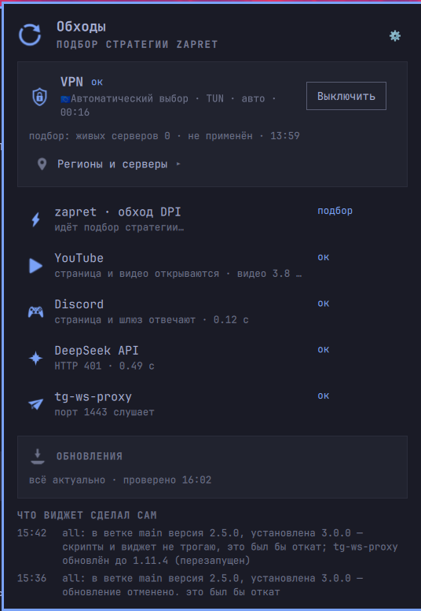

# Обходы

**Виджет для бара Omarchy, который держит YouTube, Discord, Telegram и нужные
сервисы рабочими в любой сети — и обычно вы его не замечаете.**

Он объединяет четыре вещи, которые обычно настраивают по отдельности: обход
блокировок без VPN (zapret), сам VPN, локальный прокси для Telegram и надзор,
который сам чинит то, что отвалилось. Где можно обойтись без VPN — плагин
обходится; где нельзя — включает туннель; где что-то сломалось — лечит и
показывает, что именно сделал.



---

## Если коротко

- Включили один раз — дальше плагин работает сам.
- В баре — маленькая иконка. Пока всё хорошо, она серая и молчит. Цвет
  появляется только при проблеме или во время работы.
- Левый клик открывает панель: состояние VPN, регион и сервер, строки сервисов,
  обновления и журнал того, что плагин сделал сам.
- Шестерёнка в панели открывает настройки: маршруты сайтов, списки
  заблокированного в РФ, адрес подписки и полный сброс.
- Почти всё можно сделать без терминала. Терминал нужен только для установки и
  для обновления ядра (Xray и sing-box) — там требуется пароль.

---

## Какую проблему это решает

Блокировки у всех разные, и «просто включить VPN» часто делает хуже:

- YouTube открывается, но видео не грузится — потому что видео пошло через
  зарубежный туннель;
- Discord не пускает в голосовой шлюз;
- Telegram работает, но медленно;
- российские сервисы (MAX, Яндекс) через зарубежный VPN начинают тормозить;
- API ассистента через VPN периодически отваливается.

Поэтому плагин не выбирает «одно решение на всё». Он решает каждую задачу
своим способом и следит, чтобы это продолжало работать.

---

## Как теперь работает

### 1. Обход без VPN (zapret)

zapret умеет обходить блокировки провайдера, не заворачивая трафик в туннель.
Он не универсален: в каждой сети работает своя стратегия, а в некоторых не
работает ни одна.

Поэтому плагин не гадает, а **подбирает стратегию под конкретную сеть** и
запоминает результат:

- сеть опознаётся по имени Wi-Fi (или по MAC шлюза, если это кабель);
- при первом подключении к новой сети перебираются варианты и выбирается
  рабочий;
- решение хранится отдельно для каждой сети: «работает стратегия №11»,
  «обход не работает — нужен VPN», «сеть чистая, обход не нужен»;
- если обход перестал работать, плагин возвращается к перебору — но не чаще
  раза в полчаса, и с затуханием: 30 минут → час → два → четыре → шесть. Так
  сеть, где обхода нет вовсе, не перебирается каждые полчаса и не мешает
  работать.

### 2. Туннель (VPN)

VPN — это Xray и sing-box. Трафик заворачивается в туннель `omavpn0`; снаружи
видно только адрес сервера подписки.

- Поддерживаются подписки Happ/Xray (JSON, в том числе base64) и обычные
  share-ссылки `vless://`, `vmess://`, `trojan://`, `ss://`, `socks://`.
- Профили (регионы) и серверы переключаются из панели. Есть автоподбор лучшего
  сервера по реальным пробам.
- Пароль при включении VPN не спрашивается: права на туннель выдаются один раз
  при установке.
- `hysteria2`, `tuic` и `wireguard` в подписке пропускаются: их не умеет
  Xray-core.

### 3. Маршруты: что идёт через VPN, а что напрямую

Это главная часть, из-за которой всё работает быстро. По умолчанию почти весь
трафик идёт через туннель. Исключения — то, чему туннель только мешает:

| Что | Куда идёт | Почему |
|---|---|---|
| Telegram Desktop | через локальный прокси `tg-ws-proxy` | так быстрее и стабильнее |
| `api.telegram.org` | через VPN | напрямую блокируется |
| MAX, Яндекс, DeepSeek | напрямую | через зарубежный выход работают хуже |
| YouTube (страница и видео) | через zapret, если обход в этой сети работает; иначе — через VPN | видео через туннель почти не грузится, но без обхода прямой путь может быть закрыт |
| Discord | через zapret, если обход работает; иначе — через VPN | то же самое |
| Служебный API YouTube (`youtubei`) | всегда через VPN | напрямую блокируется наглухо |
| Заблокированное в РФ (Re:filter) | через VPN | ради этого списки и нужны |
| Серверы подписки и сам Xray | напрямую | иначе туннель замкнётся сам на себя |
| Локальная сеть, Tailscale | напрямую | им нужен прямой путь |
| Почта (25/465/587) | напрямую | письма через прокси не гоняем |
| IPv6 | блокируется | профили Xray его не поддерживают |

Маршрут каждого домена можно переопределить вручную: **Настройки → Маршруты
сайтов**. Правило важнее встроенных списков и переживает перезапуски.

Отдельно работает **аудит маршрутов**. Каждые 10 минут он проверяет ключевые
домены и смотрит, отвечают ли они по своему пути:

- домен не отвечает своим путём — переводится на рабочий (и это видно в
  журнале);
- обход снова заработал, а сервис всё ещё сидит в VPN — аудит возвращает его
  напрямую, чтобы не гонять лишнее через туннель;
- ручные правила человека аудит не трогает никогда.

### 4. Надзор

`omavpn-guard` каждые 10 минут проверяет, что YouTube, Discord и Telegram
действительно работают, и лечит поломки по шагам:

1. перезапускает Telegram-прокси, если он отвалился;
2. перезапускает VPN, если туннель «числится живым», но не отвечает;
3. просит zapret перепроверить стратегию;
4. перебирает серверы подписки (до пяти);
5. в крайнем случае переводит конкретный сломанный сервис в VPN.

При этом VPN никогда не выключается сам: если вы выключили его руками, надзор
это уважает.

Важное правило: **во время перебора стратегий zapret надзор не проверяет
сервисы**. Перебор на несколько секунд останавливает обход, и раньше из-за
этого надзор принимал нормальную работу за поломку, набирал ложные «неудачи» и
уходил в паузу на полчаса. Теперь он просто ждёт.

### 5. DNS

В сетях, где провайдер режет DNS, обычный VPN обычно не поднимается: чтобы
подключиться к серверу, нужно узнать его адрес, а DNS уже не работает.
Плагин решает это так:

- имена серверов подписки резолвятся **до** поднятия туннеля — через
  DNS-over-HTTPS по известному IP-адресу (`1.1.1.1`, запасные `1.0.0.1` и
  `8.8.8.8`), без запроса к DNS провайдера;
- если этот путь недоступен, используется российский резолвер;
- обычный DNS внутри туннеля тоже идёт по HTTPS, а не по UDP, который часто
  режут.

Проще говоря: «VPN включён, а интернета нет» из-за DNS больше не случается.

---

## Что вы видите

### Иконка в баре

| Иконка | Когда | Цвет |
|---|---|---|
| галочка | всё работает, делать нечего | серый в тихом режиме, иначе акцентный |
| восклицание | что-то не работает или есть замечания | янтарный или тревожный |
| стрелки | идёт проверка или подбор сервера | янтарный |
| стрелки | идёт подбор стратегии zapret — это штатная работа | акцентный, не тревожный |
| щит | данных ещё нет или VPN выключен | обычный |

Если данные перестали поступать, иконка честно показывает восклицание, а не
зелёную галочку по старому кэшу.

### Панель

Сверху вниз:

1. **VPN** — включён или выключен, регион, сервер, режим (TUN или SOCKS),
   время работы и кнопка переключения. По строке «Регионы и серверы»
   раскрывается список: ★ — лучший сервер, ● — текущий.
2. **Сервисы** — zapret, YouTube, Discord, DeepSeek API, tg-ws-proxy. У каждой
   строки состояние (`ок`, `внимание`, `сбой`, `выкл`) и детали проверки.
3. **Обновления** — что устарело и кнопка «Обновить всё». Если всё свежее, одна
   приглушённая строка «всё актуально».
4. **Что виджет сделал сам** — последние автоматические действия за два часа.
   Старые записи не показываются.
5. **Шестерёнка** — экран настроек.

### Настройки

- «Подключаться при входе» и «Тихая иконка».
- Кнопки: «Проверить всё», «Подобрать лучший», «Тест стратегий», «Проверить
  маршруты», «Обновить подписку».
- Маршруты сайтов: добавить домен и выбрать «Напрямую» или «Через VPN».
- «Блокировки РФ» (Re:filter): включить или выключить и обновить списки.
- «Подписка»: заменить адрес без терминала.
- «Полный сброс» — если всё зависло.

---

## Что плагин делает сам

| Что | Когда | Нужно ли что-то нажимать |
|---|---|---|
| Проверка сервисов и лечение | каждые 10 минут | нет |
| Аудит маршрутов | каждые 10 минут | нет |
| Возврат сервисов на прямой путь, когда обход заработал | при аудите | нет |
| Перепроверка старых правил маршрутов | раз в сутки | нет |
| Подбор стратегии zapret под сеть | при смене сети, загрузке и по таймеру | нет |
| Обновление списков заблокированного в РФ | раз в сутки | нет |
| Проверка обновлений | раз в сутки и при открытии панели | нет |
| Подъём VPN при входе, если он был включён | при входе в систему | нет |

---

## Как плагин ведёт себя в разных сетях

**Сеть без блокировок.** Обход не нужен, плагин это замечает и не трогает
трафик. Прямые сервисы идут напрямую, остальное — через VPN, если он включён.

**Сеть, где YouTube режется, но обход работает.** Видео и Discord идут мимо
VPN, через zapret. Туннель остаётся для заблокированного в РФ и для служебных
API. Это самый быстрый режим.

**Сеть, где ни одна стратегия обхода не работает.** Плагин переводит
YouTube и Discord в туннель: страница и видео открываются, пусть и медленнее.
Перебор повторяется редко (с затуханием до 6 часов), чтобы не мешать.

**Сеть, где режут DNS.** Плагин поднимает туннель через DoH по IP и не зависит
от DNS провайдера.

**VPN выключен руками.** Плагин не включает его молча. Сначала пытается
починить обход, и только если не выходит — предлагает VPN.

**Интернет пропал совсем.** Иконка показывает проблему, а не зелёную галочку;
в панели видно, какая проверка не прошла.

---

## Установка

Нужны Omarchy (Arch/Hyprland), `yay`, `curl`, `python3`. Установка идёт от
обычного пользователя; root попросят один раз — выдать права `sing-box`.

```bash
git clone https://github.com/Blazeeers/VPN-TGWSProxy-Zapret-orchestrate.git
cd VPN-TGWSProxy-Zapret-orchestrate
./install.sh
```

Скрипт скачает Xray и sing-box в `~/.local/share/omavpn/bin`, поставит CLI,
виджет, надзиратель, таймеры, списки Re:filter и drop-in для Telegram-прокси.

### Чтобы VPN не спрашивал пароль

Один раз поставьте правило polkit (замените `USER_NAME` на свой логин):

```bash
sudo install -m 0644 docs/polkit/49-omavpn-resolved.rules /etc/polkit-1/rules.d/
sudo systemctl restart polkit
```

Без этого всё работает, но при каждом включении и выключении VPN появится
запрос пароля.

### Подписка

URL подписки в репозитории не хранится. Положите его в файл с правами 600:

```bash
printf '%s\n' 'https://<ваш-URL-подписки>' > ~/.config/omavpn/subscription
chmod 600 ~/.config/omavpn/subscription
omavpn update
```

Или без терминала: **Настройки → Подписка**. Новый адрес сразу проверяется
загрузкой; если он не работает, возвращается прежний — подписка не теряется.

### zapret, автотюн и Telegram-прокси

```bash
yay -S zapret-git
sudo bash zapret/zapret-setup.sh
sudo bash zapret/zapret-hostlist.sh
sudo bash zapret/zapret-autotune-install.sh

bash tgwsproxy/install.sh
```

### Как плагин Omarchy

```bash
omarchy plugin add https://github.com/Blazeeers/VPN-TGWSProxy-Zapret-orchestrate.git --enable
```

Если виджета не видно в баре:

```bash
omarchy plugin enable io.github.blazeeers.omavpn
omarchy bar move io.github.blazeeers.omavpn --section right
```

### Удаление

```bash
./uninstall.sh            # убрать программу, данные оставить
./uninstall.sh --purge    # убрать и данные
```

---

## Обновления

Проверка идёт сама раз в сутки и при открытии панели. Когда обновления есть, в
панели появляется раздел «Обновления» и кнопка **«Обновить всё»**.

| Что | Как обновляется | Нужен пароль |
|---|---|---|
| Виджет | скачивается из GitHub, старая версия сохраняется в бэкап | нет |
| zapret | системный пакет | да |
| tg-ws-proxy | последний релиз с GitHub, с проверкой контрольной суммы | нет |
| Xray, sing-box | только до версий, закреплённых в `install.sh`, через установщик в терминале | да |

Почему ядро не обновляется «просто до последнего»: после замены `sing-box`
теряются права на туннель, и VPN перестаёт подниматься, пока их не выдадут
заново. Поэтому установщик открывается в терминале, показывает прогресс и сам
перезапускает оболочку.

**Защита от отката.** Если ветка обновлений окажется старше установленной
версии (например, вы поставили локальную сборку, а в `main` она ещё не
появилась), плагин не станет молча откатывать скрипты и виджет. Компоненты
(zapret, tg-ws-proxy) при этом обновятся, а в журнале будет честная запись:
«в ветке main версия X, установлена Y — скрипты и виджет не трогаю».

Откатить виджет вручную можно из бэкапа:

```bash
ls ~/.cache/omavpn/widget-backup-*
cp -r ~/.cache/omavpn/widget-backup-<дата>/* \
      ~/.config/omarchy/plugins/io.github.blazeeers.omavpn/
omarchy restart shell
```

---

## Если что-то не работает

Начните с панели: **Шестерёнка → «Проверить всё»**. Это полная проверка с
попыткой самовосстановления.

Дальше по ситуации:

| Симптом | Что сделать |
|---|---|
| YouTube не открывается | Проверить, какая стратегия zapret выбрана для сети. Если «vpn» — так и должно быть: видео идёт через туннель. |
| Видео тормозит | Посмотреть, идёт ли оно напрямую. Если через туннель — обход в этой сети не работает; можно подождать подбора или нажать «Тест стратегий». |
| Discord не работает | «Проверить маршруты» — аудит переведёт домен на рабочий путь. |
| Telegram медленный | Проверить строку `tg-ws-proxy` в панели: порт 1443 должен слушать. |
| VPN включён, интернета нет | «Проверить всё», затем `omavpn heal`. Если не помогло — `omavpn best --apply`. |
| Всё зависло | **Настройки → Полный сброс**. Подписка, маршруты и настройки сохранятся. |

Для продвинутых есть журналы:

```bash
omavpn logs                    # хвост логов VPN
journalctl --user -u omavpn-guard.service -n 50
tail -n 50 /var/log/zapret-autotune.log
```

---

## Команды

Всё, что делает виджет, доступно из терминала:

```bash
omavpn on                       # подключить VPN
omavpn off                      # отключить
omavpn toggle                   # переключить
omavpn status                   # состояние
omavpn profiles                 # регионы подписки
omavpn nodes                    # серверы текущего региона
omavpn profile 2                # выбрать регион
omavpn node 5                   # выбрать сервер (-1 — авто)
omavpn best --apply             # подобрать и применить лучшую пару
omavpn probe                    # тест серверов текущего региона
omavpn heal                     # самовосстановление
omavpn check                    # проверить внешний IP
omavpn route list               # маршруты доменов
omavpn refilter status          # списки заблокированного в РФ
omavpn subscription get         # текущий адрес подписки
omavpn subscription set <url>   # заменить адрес подписки
omavpn reset                    # полный сброс
```

`omavpn reset` останавливает VPN и службы, убивает зависшие процессы и удаляет
временное состояние. Подписка, настройки, маршруты и списки Re:filter остаются.
Если VPN был включён, он поднимается заново (отключить это можно
`--no-restart`).

---

## Файлы и пути

| Что | Где |
|---|---|
| Настройки | `~/.config/omavpn/settings.json` |
| Адрес подписки | `~/.config/omavpn/subscription` (права 600) |
| Свои маршруты | `~/.config/omavpn/route_overrides.json` |
| Состояние и конфиги | `~/.local/state/omavpn/` |
| Кэш подписки и пробы | `~/.cache/omavpn/` |
| Ядро (Xray, sing-box) | `~/.local/share/omavpn/bin/` |
| Решения автотюна по сетям | `/var/lib/zapret-autotune/` |
| Журнал надзора | `~/.local/state/omavpn-guard/guard.log` |

---

## Ограничения

- Только Omarchy (Arch/Hyprland). На других системах скрипты не проверялись.
- `hysteria2`, `tuic`, `wireguard` в подписке не поддерживаются.
- IPv6 в туннеле блокируется.
- Прямой путь для видео YouTube возможен только там, где zapret подобрал
  рабочую стратегию; иначе видео идёт через туннель.
- Автообновление виджета идёт из ветки `main` без криптографической подписи —
  тот же уровень доверия, что и у самого плагина.

---

## Для разработчика

- CLI — `bin/omavpn` (Python), надзор — `bin/omavpn-guard` (bash), проверки,
  аудит и обновления — `bin/bypass-status`, апдейтер — `bin/omavpn-updater`.
- Виджет — `shell-plugin/bypass-status/Panel.qml` (Qt Quick / Quickshell).
- Автотюн zapret — `zapret/zapret-autotune` (bash, root-таймер).
- Установка — `install.sh`, удаление — `uninstall.sh`.
- История изменений — [CHANGELOG.md](CHANGELOG.md), подробности по надзору —
  [docs/guard.md](docs/guard.md), по автотюну — [docs/zapret.md](docs/zapret.md),
  по аудиту маршрутов — [docs/route-audit.md](docs/route-audit.md).

---

## Благодарности

Проект стоит на плечах чужих инструментов: [Xray-core](https://github.com/XTLS/Xray-core),
[sing-box](https://github.com/SagerNet/sing-box), [zapret](https://github.com/bol-van/zapret),
[Re-filter-lists](https://github.com/1andrevich/Re-filter-lists) и
[tg-ws-proxy](https://github.com/Flowseal/tg-ws-proxy).

## Лицензия

См. [LICENSE](LICENSE).
